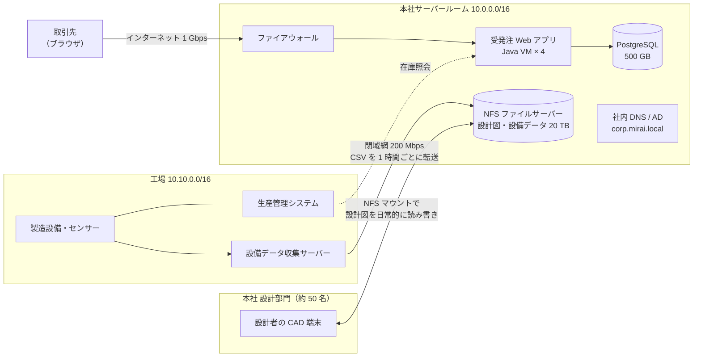
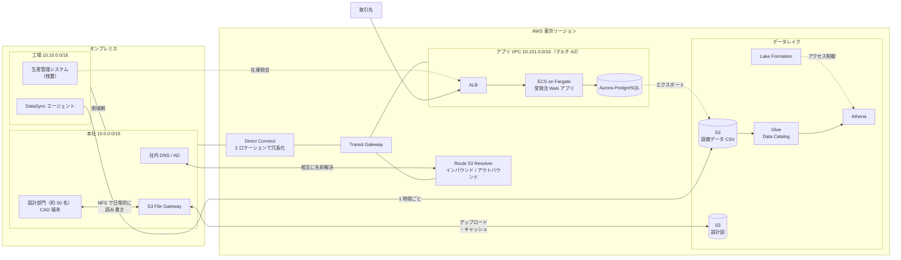
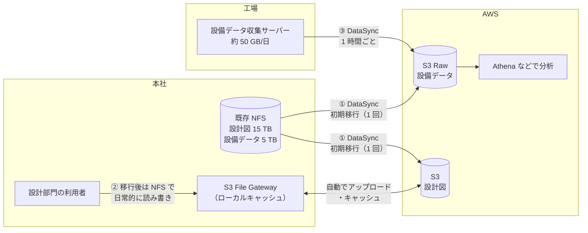

# グループ演習課題：株式会社ミライ精機 クラウド移行アーキテクチャ設計

> 対象コース：Advanced Architecting on AWS
> 実施形式：グループ演習（1 グループ 3〜5 名）

---

## 0. 演習のねらい

架空の製造業「株式会社ミライ精機」のオンプレミスシステムを AWS へ移行するとき、どのようなアーキテクチャが望ましいかをグループで検討します。

正解は 1 つではありません。「なぜその構成を選んだのか」を要件と結び付けて説明できることを重視します。

---

## 1. 企業概要

- 業種：産業用精密部品の製造・販売（架空の企業）
- 拠点：本社（東京、サーバールームあり）、工場（愛知）
- IT 部門：運用担当 3 名。コンテナの運用経験はほとんどない
- 今後の方針：移行後は、開発環境やデータ分析用の環境を AWS 上に順次追加していく予定

---

## 2. 現行システム構成

### 2.1 構成図（図 1）



### 2.2 システム一覧

| ID | システム | 現行構成 | 課題 |
|---|---|---|---|
| S1 | 受発注 Web アプリ | Java の VM 4 台、PostgreSQL 500 GB | 月末にアクセスが集中して遅くなる。リリースは手作業で停止を伴う。開発環境では動くのに本番では動かない障害が、リリースのたびに起きている（Java やライブラリのバージョン、OS の設定が環境ごとに異なる）。VM の OS パッチ適用に毎月多くの工数がかかっている |
| S2 | 生産管理システム | 工場内のサーバー | 製造設備と低遅延で通信する必要がある |
| S3 | ファイルサーバー | NFS 20 TB（設計図 15 TB、設備データ 5 TB）。本社の設計部門（約 50 名）が CAD 端末から NFS でマウントし、業務時間中に設計図を日常的に開いて編集・保存している。CAD ファイルは 1 つあたり数十 MB〜数百 MB と大きい | 容量が逼迫している |
| S4 | 設備データ収集 | 工場の収集サーバーから本社 NFS へ CSV を転送（約 50 GB/日） | データは溜まる一方で、ほとんど分析に使われていない |

### 2.3 ネットワークの現状

- 本社と工場は、通信事業者の閉域網（IP-VPN）で接続されています。工場からインターネットへ直接接続する回線はありません。
- 契約中の通信事業者は、閉域網から AWS Direct Connect へ接続するサービスも提供しています。
- 社内で利用中のアドレス帯は `10.0.0.0/16`（本社）と `10.10.0.0/16`（工場）です。

---

## 3. 要件と制約

| ID | 種別 | 内容 |
|---|---|---|
| R-1 | 要件 | 本社サーバールームの機器は 2 年後に保守が終了する。可能なシステムは AWS へ移行したい |
| R-2 | 要件 | 受発注 Web アプリは月末のピークに自動で対応し、無停止でリリースできるようにしたい |
| R-3 | 要件 | 工場の設備データと受発注データを組み合わせて、品質保証部が不良の傾向を分析できるようにしたい |
| R-4 | 要件 | オンプレミスと AWS の間で、お互いのサーバー名を名前解決できること |
| R-5 | 要件 | 工場の生産管理システムから AWS 上の在庫照会を行うため、オンプレミスと AWS の間は、業務時間中も帯域と遅延が安定していること |
| R-6 | 要件 | 単一の回線や機器の障害で、オンプレミスと AWS の間の通信が止まらないこと |
| R-7 | 要件 | 移行後も、設計部門はこれまでと同じようにファイル共有として設計図を読み書きできること。CAD ファイルを開く・保存するときの待ち時間は、現在と同程度に保つこと |
| R-8 | 要件 | 営業部にも分析用のデータを公開したい。ただし、営業部には受発注データのうち取引先名・金額などの一部の列だけを見せ、設備データは見せないこと |
| C-1 | 制約 | 生産管理システム（S2）は工場に残すこと |
| C-2 | 制約 | 業務時間（9:00〜18:00）のネットワーク帯域を移行作業で圧迫しないこと |
| C-3 | 制約 | 運用担当は 3 名のみ。運用負荷の低い構成にしたい |
| C-4 | 制約 | 社内のセキュリティポリシーにより、社内システム間の通信（設計図データ、設備データ、在庫照会など）はインターネットを経由させてはならない。暗号化していても不可とする |

---

## 付録 A：概算用データ

| 項目 | 値 |
|---|---|
| NFS のデータ量 | 20 TB |
| Direct Connect（予定） | 1 Gbps |
| 工場と本社間の閉域網 | 200 Mbps |
| 設備データの発生量 | 約 50 GB/日 |

**転送時間の計算式**

```text
転送時間（秒）= データ量（bit） ÷ 実効帯域（bps）

例：1 TB を 1 Gbps の 80% で転送する場合
  1 × 10^12 × 8 bit ÷ (0.8 × 10^9 bps) = 10,000 秒 ≈ 2.8 時間
```

---

## 付録 B：講師用 参考解答例

> このセクションは受講者への配布前に削除してください。あくまで一例です。

### B.1 検討テーマ

検討が進まないグループに提示する問いの例です。時間が足りない場合は、各テーマの問い 1 を優先して提示してください。

#### テーマ 1：ハイブリッドネットワーク

1. 本社・工場と AWS を、どの接続サービスで接続しますか。サイト間 VPN と Direct Connect を比較し、R-5、C-4 を踏まえて選んでください。
2. R-6 を満たすため、回線をどのように冗長化しますか。工場からの通信はどの経路で AWS へ届きますか。
3. 複数の VPC とオンプレミスをつなぐ場合、どのサービスをハブにしますか。
4. R-4 を満たすため、DNS をどう構成しますか。

> ヒント：Direct Connect ゲートウェイ、トランジット仮想インターフェイス（VIF）、Direct Connect の回復性に関する推奨構成、AWS Transit Gateway、Amazon Route 53 Resolver（インバウンド / アウトバウンドエンドポイント）

#### テーマ 2：受発注 Web アプリの移行方式

1. 受発注 Web アプリ（S1）を、VM のまま Amazon EC2 へ移行しますか（Rehost）、それともコンテナ化して Amazon ECS で動かしますか（Replatform）。S1 の課題と R-2、C-3 を踏まえて選んでください。
2. ECS を選んだ場合、起動タイプは AWS Fargate と Amazon EC2 のどちらにしますか。
3. R-2（ピーク対応、無停止リリース）をどのように実現しますか。
4. PostgreSQL はどこへ移行しますか。

> ヒント：Amazon EC2 Auto Scaling、Amazon ECS、Application Load Balancer、ECS Service Auto Scaling、ローリング / ブルー/グリーンデプロイ、Amazon Aurora、Amazon RDS

#### テーマ 3：ファイルデータの移行（AWS DataSync）

1. NFS の 20 TB を AWS へ移行するのに何日かかりますか。付録 A の計算式で概算してください。
2. DataSync エージェントはどこに置きますか。C-2 を守るために何を設定しますか。
3. 移行後も工場から毎日発生する設備データ（約 50 GB/日）を、どのように AWS へ送り続けますか。
4. 移行後、設計部門はどのように設計図を読み書きしますか。R-7 を踏まえて、利用者側の構成を考えてください。

> ヒント：DataSync のスケジュール、帯域制限、AWS Storage Gateway（S3 File Gateway）

#### テーマ 4：データレイクの活用

1. 設備データ（CSV）と受発注データを、どのように S3 のデータレイクに集めますか。
2. 品質保証部が SQL で分析できるようにするには、どのサービスを使いますか。
3. R-8 を満たすため、営業部に見せるデータをどう制御しますか。

> ヒント：AWS Glue（クローラー、Data Catalog）、Amazon Athena、AWS Lake Formation

### B.2 移行方針（例）

| ID | システム | 方針 | 移行先・主なサービス | 理由 |
|---|---|---|---|---|
| S1 | 受発注 Web アプリ | 移行 | ECS on Fargate、ALB、Aurora PostgreSQL | 環境差異による障害と OS パッチ適用の工数を解消し、自動スケールと無停止リリースが可能（R-2、C-3） |
| S2 | 生産管理システム | 残す | 工場に残置 | 製造設備との低遅延通信が必要（C-1） |
| S3 | ファイルサーバー | 移行 | DataSync で S3 へ移行し、本社に S3 File Gateway を設置 | 容量の制約がなくなり、設計部門は引き続き NFS として読み書きできる。よく使うファイルはローカルのキャッシュから読めるため、待ち時間も抑えられる（R-1、R-7） |
| S4 | 設備データ収集 | 移行 | 工場の DataSync エージェントから S3 へ定期転送 | 設備データをデータレイクで分析に活用できる（R-3） |

### B.3 参考構成図（図 2）



### B.4 テーマ別の解答ポイント（例）

**テーマ 1：ハイブリッドネットワーク**

- サイト間 VPN はインターネットを経由するため C-4 に反します。また、帯域と遅延が安定しないため R-5 も満たしにくいので、Direct Connect を選びます。
- R-6 を満たすため、異なる Direct Connect ロケーションに 2 回線を用意します。VPN をバックアップにする構成は C-4 により使えません。
- 工場は既存の閉域網で本社を経由させるか、通信事業者の閉域網から Direct Connect へ接続するサービスを使います。どちらの場合もインターネットを経由しません。
- 開発環境やデータ分析用の環境を追加する予定（企業概要）があり VPC が増えるため、Transit Gateway をハブにします。
- Route 53 Resolver のアウトバウンドエンドポイントで `corp.mirai.local` の問い合わせをオンプレミスの DNS へ転送します。オンプレミスの DNS からは、インバウンドエンドポイントへ AWS 側のドメインを転送します。

**テーマ 2：受発注 Web アプリの移行方式**

- EC2 へ VM のまま移行すると、環境ごとの差異による障害と OS パッチ適用の工数が残ります。アプリと実行環境を 1 つのイメージにまとめられるコンテナ化（ECS）を選びます。
- 運用担当が少ないため（C-3）、OS やホストの管理が不要な Fargate を選びます。
- ALB と ECS Service Auto Scaling で月末のピークに対応し、ローリングまたはブルー/グリーンデプロイで無停止リリースを行います。
- PostgreSQL は Aurora PostgreSQL（または RDS for PostgreSQL）のマルチ AZ 構成へ移行します。

**テーマ 3：ファイルデータの移行（AWS DataSync）**

- 20 TB を 1 Gbps の 80% で転送すると、約 2.3 日（200,000 秒）です。業務時間中に帯域制限をかけた場合（例として 200 Mbps に制限すると仮定）は 4〜5 日程度を見込みます。
- エージェントは本社の NFS の近くに VM として配置し、業務時間中は帯域制限を設定するか、夜間・休日にスケジュール実行します（C-2）。
- 工場にもエージェントを置き、1 時間ごとのスケジュールタスクで設備データを S3 へ転送します。

**解説：DataSync と S3 File Gateway の使い分け**

本解答例では、データの種類と使われ方に応じて 2 つのサービスを使い分けています。



| データ | 使われ方 | 使うサービス | 理由 |
|---|---|---|---|
| 設計図・設備データの既存分（20 TB） | 一度だけ AWS へ移す | DataSync | 大量データの一括転送に向いている |
| 設計図（移行後） | 設計部門が日常的に読み書きする | S3 File Gateway | 利用者が従来どおり NFS で使い続けられる |
| 設備データ（毎日 約 50 GB） | 工場で発生し、AWS 上で分析する | DataSync | 人が直接アクセスしないため、定期転送で十分 |

**設計図に S3 File Gateway を使う理由**

- **利用者の使い方を変えない**：S3 はオブジェクトストレージのため、そのままでは NFS としてマウントできません。File Gateway は NFS（または SMB）の共有を提供し、書き込まれたファイルを S3 のオブジェクトとして保存します。設計部門はこれまでと同じようにファイル共有として使えます（R-7）。
- **容量の逼迫を解消できる**：データの実体は S3 に保存され、オンプレミスにはよく使うファイルのキャッシュだけを置きます。S3 の容量に上限はないため、現在のファイルサーバーの容量問題（S3 の課題）が解消します。
- **応答が速い**：CAD ファイルはサイズが大きいため、毎回 Direct Connect 経由で AWS から読み込むと時間がかかります。よく使うファイルはローカルのキャッシュから読み込めるため、利用者の体感速度を保てます（R-7）。
- **データレイクと連携しやすい**：ファイルが S3 のオブジェクトとして保存されるため、将来、設計図のデータを Glue や Athena などの分析サービスで扱いたくなった場合も、そのまま使えます。

**既存データの移行に File Gateway ではなく DataSync を使う理由**

File Gateway の NFS 共有に既存の 15 TB をコピーして移行することも、技術的には可能です。ただし、次の点で DataSync のほうが移行に向いています。

| 比較項目 | DataSync | File Gateway へのコピー |
|---|---|---|
| 転送速度 | 並列転送で回線の帯域を活用できる | キャッシュの容量とアップロード速度に左右される |
| 帯域制限・スケジュール（C-2） | タスクごとに設定できる | 細かく制御しにくい |
| 差分転送 | 2 回目以降は変更分だけを転送する | コピー方法を自分で工夫する必要がある |
| 整合性の検証 | 転送後に自動で検証できる | 自分で確認する必要がある |

そのため、**移行は DataSync、移行後の日常的な利用は File Gateway** という組み合わせにしています。DataSync で S3 に直接書き込んだファイルは、File Gateway のキャッシュを更新（RefreshCache）するまで利用者から見えないため、切り替え前にキャッシュを更新します。

**File Gateway の通信経路（C-4）**

File Gateway は、何も設定しないと AWS のパブリックなエンドポイントと通信するため、インターネットを経由して C-4 に反するおそれがあります。次の VPC エンドポイントを共有サービス VPC に作成し、Direct Connect 経由で通信させます。

- **Storage Gateway の VPC エンドポイント**：File Gateway のアクティベーションや管理の通信に使います。
- **S3 のインターフェイスエンドポイント（AWS PrivateLink for Amazon S3）**：ファイルのアップロードやダウンロードに使います。S3 のゲートウェイエンドポイントはオンプレミスや Transit Gateway 経由のアクセスに使えないため、インターフェイスエンドポイントを選びます。

**設備データに File Gateway を使わない理由**

- 設備データは工場で発生し、AWS 上のデータレイクで分析されます。オンプレミスで人がファイルを開いて使うことはないため、ローカルキャッシュを持つ File Gateway の利点が生かせません。
- 1 時間ごとに約 2 GB を送るだけであれば、DataSync のスケジュールタスクで十分です。転送の成否や転送量を、タスクの実行履歴で確認できる点も運用しやすい理由です（C-3）。
- **別解**：工場に File Gateway を置き、収集サーバーの CSV の出力先を File Gateway の NFS 共有にする方法もあります。書き込まれたファイルが自動で S3 にアップロードされるため、DataSync より早く S3 に届きます。ただし、工場に File Gateway の VM を置き、キャッシュ容量の設計と運用が必要になります。どちらも妥当な選択肢で、根拠を説明できていれば正解とします。

**補足：R-1 との関係**

File Gateway はオンプレミスに置く VM（またはハードウェアアプライアンス）なので、本社の機器がすべてなくなるわけではありません。ただし、20 TB の NFS サーバーに比べると、キャッシュ用のディスクを持つ小さな VM で済みます。本社に機器を一切残したくない場合は、File Gateway を使わずに、利用者が Direct Connect 経由で AWS 上のファイル共有（Amazon EFS、Amazon FSx for NetApp ONTAP など）にアクセスする案も検討できます。その場合は、CAD ファイルを開くときの応答速度が課題になります。

**テーマ 4：データレイクの活用**

- 設備データは DataSync で S3 へ、受発注データは Aurora から S3 へエクスポートして、データレイクに集約します。
- Glue クローラーで Data Catalog を作成し、Athena で SQL 分析します。
- Lake Formation で、部門ごとにテーブルや列単位のアクセス権を設定し、営業部には受発注データの一部の列だけを許可します（R-8）。

### B.5 講評で取り上げたい論点

- 要件と制約（R-5、C-4）から、サイト間 VPN ではなく Direct Connect を選ぶ理由を説明できているか
- Direct Connect を冗長化できているか（R-6）
- 「すべて移行」ではなく、生産管理システムのように残すべきものを根拠を持って判断できているか（C-1）
- DataSync の転送時間を数値で見積もれているか
- 設計図を S3 へ転送するだけでなく、移行後も設計部門が NFS で読み書きできる構成を考えられているか（R-7）
- File Gateway や DataSync の通信もインターネットを経由しないよう、VPC エンドポイントを使えているか（C-4）
- 営業部に見せるデータを、列単位で制御できているか（R-8）
- 運用負荷を下げるために、マネージドサービスを選択できているか（C-3）
