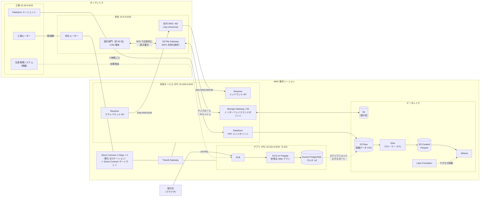
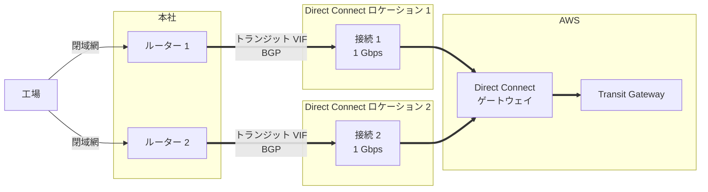
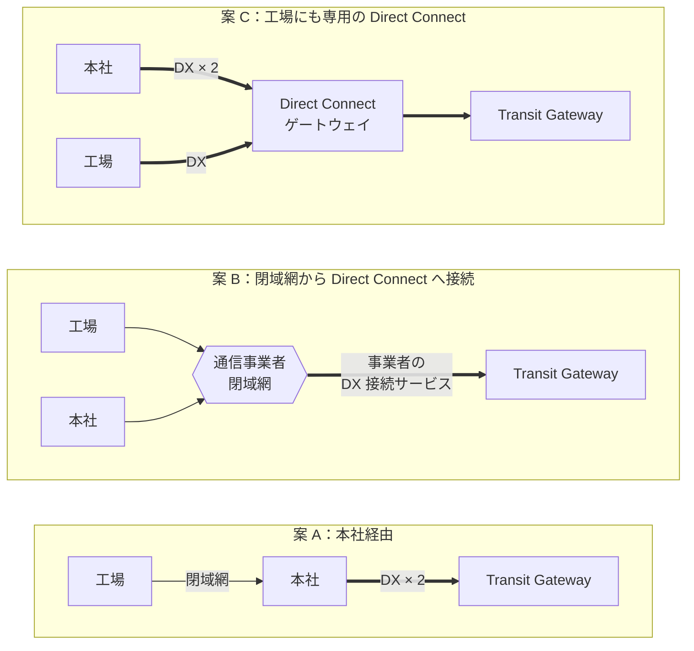
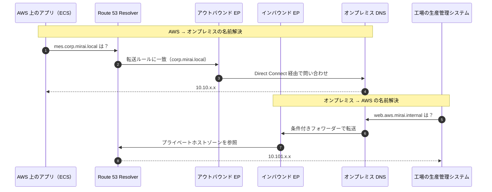
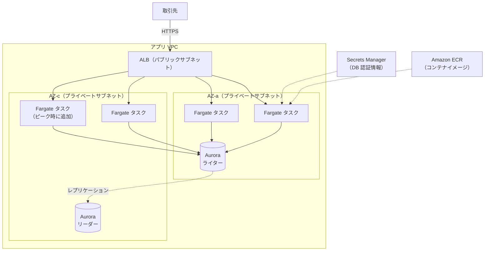
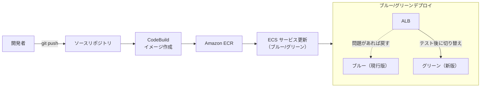
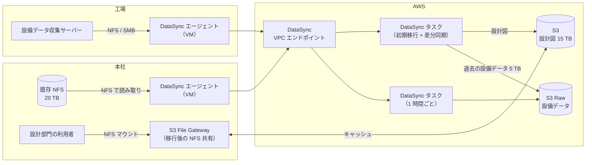
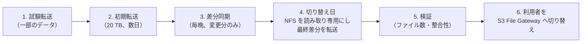
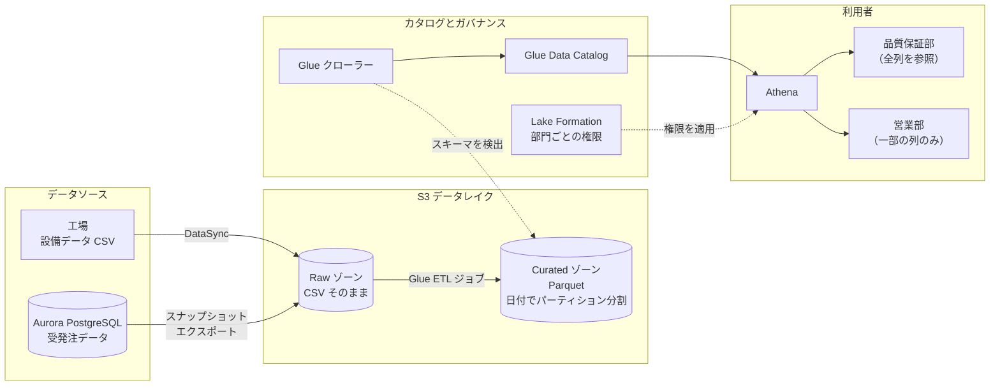

# グループ演習 解答例：株式会社ミライ精機 クラウド移行アーキテクチャ設計

> 本書は「グループ演習課題案_ハイブリッド移行アーキテクチャ.md」の講師用解答例です。
> 解答は一例です。要件や制約の解釈によって、ほかの構成も十分に成り立ちます。要件・制約とどう結び付いているかについては、この解答例を参考にしてください。

---

## 1. 解答の全体像

### 1.1 移行方針

| ID | システム | 方針 | 7R での分類 | 移行先・主なサービス | 理由 |
|---|---|---|---|---|---|
| S1 | 受発注 Web アプリ | 移行 | Replatform | Amazon ECS on AWS Fargate、Application Load Balancer（ALB）、Amazon Aurora PostgreSQL | 環境差異による障害と OS パッチ適用の工数を解消できる。自動スケールと無停止リリースも実現できる（R-2、C-3） |
| S2 | 生産管理システム | 残す | Retain | 工場に残置 | 製造設備と低遅延で通信する必要がある（C-1） |
| S3 | ファイルサーバー | 移行 | Replatform | AWS DataSync で Amazon S3 へ移行、本社に S3 File Gateway を設置 | 容量の制約がなくなる。設計部門は引き続き NFS として読み書きでき、よく使うファイルはローカルのキャッシュから読める（R-1、R-7） |
| S4 | 設備データ収集 | 移行 | Replatform | 工場の DataSync エージェントから S3 へ 1 時間ごとに転送 | 設備データをデータレイクで分析に活用できる（R-3） |

### 1.2 移行後の全体構成図（図 1）



> 補足：図を見やすくするため、在庫照会用の内部 ALB や VPC エンドポイントの詳細は省略しています。

---

## 2. ハイブリッドネットワーク

### 2.1 接続サービスの選定

**解答例：AWS Direct Connect を選びます。サイト間 VPN は C-4 と R-5 を満たせないため使いません。**

| 比較項目 | サイト間 VPN | Direct Connect | 関連する要件・制約 |
|---|---|---|---|
| 通信経路 | インターネット経由（IPsec で暗号化） | 専用線（インターネットを経由しない） | C-4 |
| 帯域・遅延 | インターネットの混雑に左右される | 安定している | R-5 |
| 構築期間 | 数時間〜数日 | 数週間〜数か月（回線の手配が必要） | — |
| コスト | 低い | 高い（ポート料金、回線費用） | — |
| 今回の判断 | ✕ C-4 に反する | ◎ 採用 | |

解説：

- **C-4 との関係**：サイト間 VPN は IPsec で暗号化されますが、通信経路はインターネットです。C-4 は「暗号化していてもインターネット経由は不可」としているため、VPN はメイン回線にもバックアップ回線にも使えません。
- **R-5 との関係**：工場の生産管理システムは、業務時間中に AWS 上の在庫照会を呼び出します。インターネットの混雑で応答が遅れると生産に影響するため、帯域と遅延が安定した Direct Connect が適しています。
- **C-4 の対象外の通信**：取引先がブラウザで受発注 Web アプリにアクセスする通信は、社外からの通信なのでインターネット経由で問題ありません。社内システム間の通信と区別できているかを確認してください。

- **補足（講評で触れる程度）**：Direct Connect は回線の手配が必要なため、サイト間 VPN のようにすぐには使えません。実際のプロジェクトでは早めに発注し、開通までの間に AWS 側の構築やアプリのコンテナ化など、オンプレミスとの通信が不要な作業を進めるのが一般的です。

### 2.2 回線の冗長化（R-6）と工場からの経路

**解答例：本社に、異なる Direct Connect ロケーションへの 2 回線を用意します。オンプレミス側のルーターも 2 台にします。**



解説：

- **冗長化の考え方**：AWS は Direct Connect の回復性について、いくつかの推奨構成を示しています。今回は「単一の回線や機器の障害で止まらない」（R-6）ことが要件なので、**2 つの異なるロケーションにそれぞれ 1 回線**を用意する構成で要件を満たせます。ロケーションそのものの障害にも耐えられます。
- **さらに可用性を高める場合**：各ロケーションに 2 回線ずつ（合計 4 回線）用意する最大の回復性の構成もあります。ただし、今回の通信量とコストを考えると過剰です。
- **同じロケーションに 2 回線の場合**：回線や機器の障害には耐えられますが、ロケーションの障害には耐えられません。R-6 は満たしますが、2 ロケーション構成と比べた弱点を説明できるとよいでしょう。
- **VPN をバックアップにする構成**：一般的にはコストを抑えた冗長化の方法ですが、今回は C-4 により使えません。
- **ルーティング**：2 つの接続それぞれにトランジット VIF を作成し、同じ Direct Connect ゲートウェイ経由で Transit Gateway に接続します。BGP で経路を交換するため、片方の回線が切れると自動でもう片方へ切り替わります。BFD を有効にすると、障害の検知が速くなります。
- **オンプレミス側の機器**：回線を 2 本にしても、ルーターが 1 台なら単一障害点になります。ルーターも 2 台にして、それぞれの回線に接続します。

#### 工場から AWS への経路

工場はインターネット回線を持たないため（課題ファイルの「2.3 ネットワークの現状」を参照）、どの経路でも閉域網を使うことになります。



| 比較項目 | 案 A：本社経由 | 案 B：閉域網から Direct Connect へ接続 | 案 C：工場にも専用の Direct Connect |
|---|---|---|---|
| 構築の手間 | 少ない（既存の閉域網を利用） | 中程度（事業者との契約変更） | 多い（工場用の回線を新設） |
| AWS 接続のコスト | 本社の Direct Connect 2 回線分（ポート料金・回線費用）。工場の経路には既存の閉域網を使うため、工場用の費用は増えない | 事業者の Direct Connect 接続サービス料金。本社と工場の両方が閉域網から接続するため、本社に専用の Direct Connect を引かずに済む場合がある | 本社の Direct Connect 2 回線分に加え、工場用の Direct Connect 回線分。3 案の中で最も高い |
| 本社への依存 | 本社の障害で工場も AWS へ接続できない | 本社に依存しない | 本社に依存しない |
| R-1（本社機器の保守終了）との関係 | 本社のルーターと回線を維持し続ける必要がある | 本社の役割を縮小しやすい | 本社の役割を縮小しやすい |
| C-4 との関係 | 満たす | 満たす | 満たす |

解説：

- **コストの比べ方**：どの案でも AWS との接続費用はかかります。比べるときは、本社の回線も含めた総額で考えます。案 A は本社の Direct Connect 2 回線の費用だけで工場もカバーできます。案 B は事業者のサービス料金が本社の Direct Connect の代わりになる可能性があるため、総額では案 A と同程度か安くなることもあります。実際の金額は事業者の料金体系によるため、見積もりで比較します。
- **案 A**：最もシンプルで、工場のために新しい回線や契約を追加する必要がありません。ただし、工場から AWS への通信が本社の機器に依存します。移行後の主な通信（在庫照会、設備データ転送）は工場と AWS の間で発生するため、本社を経由すると遠回りにもなります。
- **案 B**：本社と工場がつながっている閉域網そのものを AWS に接続するため、工場の通信が本社に依存しなくなります。本社サーバールームを縮小する R-1 の方針と合います。冗長構成の有無や帯域は事業者のサービス内容によって異なるため、R-6 を満たすか確認が必要です。
- **案 C**：工場の通信量（約 2 GB/時）と在庫照会だけであれば、専用の Direct Connect を引くのはコストに見合いません。

**本解答例の推奨**：移行初期は案 A（本社に Direct Connect を 2 回線）で始め、本社の機器を縮小する段階で案 B への切り替えを検討します。案 B に切り替える場合は、本社の Direct Connect を解約できるかどうかも含めて、総額で判断します。最初から案 B を選ぶのも妥当です。講評では、**本社が単一障害点になる点と R-1 との関係**に気づけているかを確認してください。

### 2.3 複数の VPC とオンプレミスをつなぐハブ

**解答例：AWS Transit Gateway をハブにします。**

| 比較項目 | VPC ピアリング / 仮想プライベートゲートウェイ（VGW） | Transit Gateway |
|---|---|---|
| 接続の形 | VPC ごとに個別に接続（メッシュ型） | ハブアンドスポーク型 |
| VPC を追加したとき | 接続とルートを VPC の数だけ追加する | Transit Gateway にアタッチするだけ |
| オンプレミスとの接続 | VPC ごとに VGW と VPN / VIF が必要 | Direct Connect ゲートウェイ（トランジット VIF）や VPN を 1 か所で集約 |
| 向いている規模 | VPC が 2〜3 個で増える予定がない | VPC が今後増える |

解説：

- 今回は「アプリ VPC」「共有サービス VPC」の 2 つから始めますが、課題の企業概要にあるとおり、今後は開発環境やデータ分析用の環境を追加する予定で、VPC が増えていきます。最初から Transit Gateway にしておくと、VPC を追加しても構成が複雑になりません。
- AWS 側の CIDR（例：`10.100.0.0/16` 以降）は、オンプレミスのアドレス帯（`10.0.0.0/16`、`10.10.0.0/16`）と重複しないように割り当てます。重複するとルーティングできません。

### 2.4 相互の名前解決（R-4）のための DNS 構成

**解答例：Amazon Route 53 Resolver のインバウンドエンドポイントとアウトバウンドエンドポイントを使います。**



解説：

- **AWS → オンプレミス**：アウトバウンドエンドポイントを作成し、「`corp.mirai.local` はオンプレミス DNS へ転送する」という転送ルールを VPC に関連付けます。
- **オンプレミス → AWS**：インバウンドエンドポイントを作成し、オンプレミス DNS に「`aws.mirai.internal` はインバウンドエンドポイントの IP アドレスへ転送する」という条件付きフォワーダーを設定します。
- エンドポイントは複数の AZ に配置して冗長化します。共有サービス VPC にまとめて配置すると、ほかの VPC からも転送ルールを共有して使えます。

---

## 3. 受発注 Web アプリの移行方式

### 3.1 構成図（図 2）



### 3.2 EC2 へ移行するか、コンテナ化するか

**解答例：コンテナ化して Amazon ECS で動かします（Replatform）。**

S1 の課題を 1 つずつ、どちらの方式で解決できるかを比べます。

| S1 の課題・要件 | EC2 へ移行（Rehost） | ECS へ移行（Replatform） |
|---|---|---|
| 月末のピーク（R-2） | ○ EC2 Auto Scaling で対応できる | ○ ECS Service Auto Scaling で対応できる。起動が速い |
| 無停止リリース（R-2） | ○ CodeDeploy のブルー/グリーンデプロイで対応できる | ○ ローリング / ブルー/グリーンデプロイで対応できる |
| 環境差異による障害 | △ AMI や構成管理ツールで揃える必要があり、手間がかかる | ◎ アプリと実行環境（Java、ライブラリ、OS 設定）を 1 つのイメージにまとめ、同じイメージを全環境で使える |
| OS パッチ適用の工数（C-3） | ✕ VM の台数分、OS の管理が残る | ◎ Fargate なら OS とホストの管理が不要 |
| 移行の手間 | ◎ 少ない（VM をそのまま移せる） | △ コンテナイメージの作成と、アプリの一部改修が必要 |
| 学習コスト | ◎ 既存の知識で運用できる | △ コンテナの知識が必要（運用担当は経験が浅い） |

解説：

- **R-2 だけでは決まらない**：ピーク対応と無停止リリースは、EC2 Auto Scaling と CodeDeploy を使えば VM のままでも実現できます。R-2 だけを根拠に「コンテナ化」と答えているグループには、「EC2 ではだめなのか」と問いかけてください。
- **決め手は残りの 2 つの課題**：
  - 「開発環境では動くのに本番では動かない」障害は、環境ごとに Java やライブラリのバージョン、OS の設定が異なることが原因です。コンテナでは、これらをすべてイメージに含め、開発・テスト・本番で同じイメージを使うため、環境差異による障害を根本から減らせます。
  - OS パッチ適用の工数は、EC2 へ移行しても残ります。ECS on Fargate にすると、OS やホストの管理を AWS に任せられるため、運用担当 3 名（C-3）の負担を大きく減らせます。
- **デメリットへの対応**：コンテナ化には移行の手間と学習コストがかかります。コンテナ化の作業はオンプレミスとの通信がなくても進められるため、Direct Connect の開通を待つ間に着手できます。運用面は、Fargate やマネージドな CI/CD を選ぶことで、必要な知識を最小限に抑えられます。
- **EC2 を選んだグループへの講評**：誤りではありません。「まず EC2 へ移行して保守期限（R-1）に間に合わせ、その後コンテナ化する」という段階的な案も現実的です。その場合、環境差異と OS パッチの課題がいつ、どう解決されるかを説明できているかを確認してください。

### 3.3 起動タイプの選定（Fargate / EC2）

**解答例：AWS Fargate を選びます。**

| 比較項目 | Fargate | EC2 起動タイプ |
|---|---|---|
| サーバー（ホスト）の管理 | 不要（AWS が管理） | OS のパッチ適用やスケーリングが必要 |
| 料金 | タスクの vCPU・メモリ単位 | EC2 インスタンス単位（使い切れば割安） |
| カスタマイズ性 | 制約あり（GPU や特殊な OS 設定など） | 自由度が高い |
| 今回の適合度 | ◎ 運用担当 3 名でも運用しやすい（C-3） | △ ホスト管理の負荷が増える |

解説：

- 運用担当が 3 名と少なく、コンテナの経験も浅いため、ホストの管理が不要な Fargate が適しています。
- **ECS と EKS の比較**も話題になりやすい点です。EKS は Kubernetes のエコシステムを活用できますが、学習コストと運用負荷が高めです。今回のように 1 つの Web アプリを動かす規模であれば、ECS のほうがシンプルです。

### 3.4 ピーク対応と無停止リリース（R-2）の実現方法

**解答例：ECS Service Auto Scaling でピークに対応し、ローリングデプロイまたはブルー/グリーンデプロイで無停止リリースを行います。**



解説：

- **ピーク対応**：ECS Service Auto Scaling のターゲット追跡ポリシーで、CPU 使用率や ALB のリクエスト数に応じてタスク数を自動で増減させます。月末のように集中する時期が決まっている場合は、スケジュールに基づくスケーリングで事前にタスクを増やしておく方法も有効です。
- **無停止リリース**：ローリングデプロイでは、新しいタスクを起動して ALB のヘルスチェックに合格してから古いタスクを停止するため、サービスを止めずに更新できます。ブルー/グリーンデプロイでは、新しい環境をテストしてからトラフィックを切り替えるため、問題があればすぐ元に戻せます。
- **CI/CD**：AWS CodePipeline でビルドからデプロイまでを自動化すると、手作業によるミスを減らせます（M7 の内容と関連付けて講評するとよいでしょう）。
- **アプリの前提**：水平スケールするには、セッション情報をコンテナ内に持たない（ステートレスにする）必要があります。セッションは Amazon ElastiCache や DB に保存します。

### 3.5 PostgreSQL の移行先

**解答例：Amazon Aurora PostgreSQL のマルチ AZ 構成に移行します。**

解説：

- Aurora はストレージが 3 つの AZ に自動で複製され、障害時は数十秒程度でリーダーへフェイルオーバーします。バックアップやパッチ適用も AWS が管理するため、運用負荷を減らせます。
- Amazon RDS for PostgreSQL（マルチ AZ）も妥当な選択肢です。コストを重視する場合は RDS、可用性や読み取り性能のスケールを重視する場合は Aurora、と説明できれば十分です。
- **移行方法**：AWS DMS（フルロード + 継続的なレプリケーション）を使うと、切り替え時の停止時間を短くできます。500 GB 程度であれば、メンテナンス時間内に `pg_dump` / `pg_restore` で移行する方法も現実的です。
- DB の認証情報は AWS Secrets Manager に保存し、ECS のタスク定義から参照します。コンテナイメージや環境変数に直接書き込まないようにします。

---

## 4. ファイルデータの移行（AWS DataSync）

### 4.1 構成図（図 3）



### 4.2 既存データ 20 TB の移行にかかる日数

**解答例：約 2.3 日（帯域制限を考慮すると 4〜5 日程度）です。**

```text
■ 帯域制限なしの場合（1 Gbps の 80% を使用）
  20 × 10^12 byte × 8 bit ÷ (0.8 × 10^9 bps)
  = 160 × 10^12 ÷ 0.8 × 10^9
  = 200,000 秒 ≈ 55.6 時間 ≈ 2.3 日

■ 業務時間中は帯域を 200 Mbps に制限する場合（C-2 を守るための仮定の値）
  夜間・休日（15 時間）：0.8 Gbps → 1 時間あたり約 360 GB → 約 5.4 TB
  業務時間（9 時間）  ：0.2 Gbps → 1 時間あたり約 90 GB  → 約 0.8 TB
  1 日あたり 約 6.2 TB → 20 TB ÷ 6.2 TB ≈ 3.3 日

  ファイル数が多い場合のオーバーヘッドや再転送を考慮し、4〜5 日程度を見込む
```

解説：

- 課題の C-2 は具体的な帯域の上限を示していないため、200 Mbps は本解答例での仮定です。受講者が別の値を仮定していても、仮定を明示して計算できていれば問題ありません。
- 数日で完了するため、AWS Snowball などのオフライン転送は不要と判断できます。目安として、オンライン転送に数週間以上かかる場合に Snowball を検討します。
- C-4 によりインターネット経由の転送はできないため、移行は **Direct Connect の開通後**に行います。計算に使う帯域も Direct Connect の 1 Gbps です。
- 実際の転送速度はファイル数やファイルサイズにも影響されるため、本番移行の前に一部のデータで試験転送を行い、所要時間を確認します。

### 4.3 DataSync エージェントの配置と帯域の制御（C-2）

**解答例：エージェントは本社の NFS サーバーの近くに VM として配置します。帯域制限とスケジュールを設定して、業務時間の帯域を圧迫しないようにします。**

解説：

- **エージェントの配置**：DataSync エージェントは、オンプレミスのハイパーバイザー（VMware、Hyper-V、KVM）上に VM として配置します。NFS サーバーと同じ LAN に置くと、読み取りが速くなります。
- **転送経路**：DataSync の VPC エンドポイント（AWS PrivateLink）を使うと、Direct Connect を経由したプライベートな経路で転送できます。インターネットを経由しないため C-4 を満たします。データは TLS で暗号化されて転送されます。
- **帯域制限**：DataSync タスクに帯域の上限を設定できます。タスクの実行中でも上限を変更できるため、業務時間中は低く、夜間は高く設定する運用ができます。
- **スケジュール**：夜間・休日にタスクを実行するスケジュールを設定します。

**移行の手順（例）**



- DataSync は 2 回目以降、変更されたファイルだけを転送するため、差分同期は短時間で終わります。
- 移行後も設計部門が NFS としてファイルを扱えるように、本社に **S3 File Gateway** を設置します。よく使うファイルはローカルにキャッシュされるため、利用者は従来と同じ感覚で使えます。
- 注意点：DataSync など File Gateway 以外の経路で S3 に書き込んだファイルは、File Gateway のキャッシュを更新（RefreshCache）しないと利用者から見えません。切り替え前にキャッシュを更新する手順を入れておきます。

### 4.4 設備データ（約 50 GB/日）の継続的な転送

**解答例：工場にも DataSync エージェントを配置し、1 時間ごとのスケジュールタスクで S3 へ転送します。**

```text
1 時間あたりのデータ量：50 GB ÷ 24 ≈ 2.1 GB
工場の閉域網 200 Mbps の 80%（160 Mbps）で転送する場合
  2.1 × 10^9 × 8 bit ÷ (160 × 10^6 bps) ≈ 105 秒 ≈ 約 2 分
```

解説：

- 1 時間ごとに約 2 分で転送が終わるため、工場の回線への影響は小さいと判断できます。
- 本社の NFS を経由せず、工場から直接 AWS へ送ることで、本社サーバールームの機器を撤去できるようになります（R-1）。
- **別解**：Amazon Data Firehose や AWS IoT Core を使ってリアルタイムに送る方法もあります。ただし、収集サーバーやアプリケーションの改修が必要です。現在の「1 時間ごとに CSV を出力する」仕組みを変えずに済む点で、DataSync が手軽です。

### 4.5 移行後の設計図の読み書き（R-7）

**解答例：本社に S3 File Gateway を設置し、設計部門の CAD 端末から File Gateway の NFS 共有をマウントして読み書きします。**

ここで確認したいのは、「DataSync で S3 へ転送すれば終わり」ではなく、**移行後に誰がどのようにデータを使うか**まで考えられているかです。S3 へ移しただけでは、設計部門は設計図を NFS で開けなくなります。

#### DataSync と S3 File Gateway の使い分け

本解答例では、データの種類と使われ方に応じて 2 つのサービスを使い分けています（図 3 を参照）。File Gateway を使っているのは**設計図**で、設備データには使っていません。

| データ | 使われ方 | 使うサービス | 理由 |
|---|---|---|---|
| 設計図・設備データの既存分（20 TB） | 一度だけ AWS へ移す | DataSync | 大量データの一括転送に向いている |
| 設計図（移行後） | 設計部門が日常的に読み書きする | S3 File Gateway | 利用者が従来どおり NFS で使い続けられる |
| 設備データ（毎日 約 50 GB） | 工場で発生し、AWS 上で分析する | DataSync | 人が直接アクセスしないため、定期転送で十分 |

#### 設計図に S3 File Gateway を使う理由

設計部門（約 50 名）は、業務時間中に CAD 端末から NFS で設計図を開いて編集・保存しています。CAD ファイルは 1 つあたり数十 MB〜数百 MB と大きいため、アクセス方法と待ち時間が重要です。

- **利用者の使い方を変えない**：S3 はオブジェクトストレージのため、そのままでは NFS としてマウントできません。File Gateway は NFS（または SMB）の共有を提供し、書き込まれたファイルを S3 のオブジェクトとして保存します。設計部門はこれまでと同じようにファイル共有として使えます（R-7）。
- **容量の逼迫を解消できる**：データの実体は S3 に保存され、オンプレミスにはよく使うファイルのキャッシュだけを置きます。S3 の容量に上限はないため、現在のファイルサーバーの容量問題（S3 の課題）が解消します。
- **応答が速い**：CAD ファイルはサイズが大きいため、毎回 Direct Connect 経由で AWS から読み込むと時間がかかります。よく使うファイルはローカルのキャッシュから読み込めるため、利用者の体感速度を保てます（R-7）。
- **データレイクと連携しやすい**：ファイルが S3 のオブジェクトとして保存されるため、将来、設計図のデータを Glue や Athena などの分析サービスで扱いたくなった場合も、そのまま使えます。

#### 既存データの移行に File Gateway ではなく DataSync を使う理由

File Gateway の NFS 共有に既存の 15 TB をコピーして移行することも、技術的には可能です。ただし、次の点で DataSync のほうが移行に向いています。

| 比較項目 | DataSync | File Gateway へのコピー |
|---|---|---|
| 転送速度 | 並列転送で回線の帯域を活用できる | キャッシュの容量とアップロード速度に左右される |
| 帯域制限・スケジュール（C-2） | タスクごとに設定できる | 細かく制御しにくい |
| 差分転送 | 2 回目以降は変更分だけを転送する | コピー方法を自分で工夫する必要がある |
| 整合性の検証 | 転送後に自動で検証できる | 自分で確認する必要がある |

そのため、**移行は DataSync、移行後の日常的な利用は File Gateway** という組み合わせにしています。4.3 の注意点のとおり、DataSync で S3 に直接書き込んだファイルは、File Gateway のキャッシュを更新（RefreshCache）するまで利用者から見えないため、切り替え前にキャッシュを更新します。

#### File Gateway の通信経路（C-4）

File Gateway は、何も設定しないと AWS のパブリックなエンドポイントと通信するため、インターネットを経由して C-4 に反するおそれがあります。次の VPC エンドポイントを共有サービス VPC に作成し、Direct Connect と Transit Gateway を経由して通信させます（図 1 を参照）。

| エンドポイント | 用途 |
|---|---|
| Storage Gateway の VPC エンドポイント | File Gateway のアクティベーションや管理の通信 |
| S3 のインターフェイスエンドポイント（AWS PrivateLink for Amazon S3） | ファイルのアップロードやダウンロード |

- S3 のエンドポイントには、ゲートウェイエンドポイントとインターフェイスエンドポイントの 2 種類があります。**ゲートウェイエンドポイントはオンプレミスや Transit Gateway 経由のアクセスに使えない**ため、オンプレミスの File Gateway からはインターフェイスエンドポイントを使います。
- DataSync も同様に、DataSync の VPC エンドポイントを使って Direct Connect 経由で転送します（4.3）。
- 「Direct Connect を引いたので、すべての通信が自動的にプライベートになる」と考えているグループには、各サービスがどのエンドポイントと通信するかを確認させてください。

#### 設備データに File Gateway を使わない理由

- 設備データは工場で発生し、AWS 上のデータレイクで分析されます。オンプレミスで人がファイルを開いて使うことはないため、ローカルキャッシュを持つ File Gateway の利点が生かせません。
- 1 時間ごとに約 2 GB を送るだけであれば、DataSync のスケジュールタスクで十分です。転送の成否や転送量を、タスクの実行履歴で確認できる点も運用しやすい理由です（C-3）。
- **別解**：工場に File Gateway を置き、収集サーバーの CSV の出力先を File Gateway の NFS 共有にする方法もあります。書き込まれたファイルが自動で S3 にアップロードされるため、DataSync より早く S3 に届きます。ただし、工場に File Gateway の VM を置き、キャッシュ容量の設計と運用が必要になります。どちらも妥当な選択肢で、根拠を説明できていれば正解とします。

#### 補足：R-1 との関係

File Gateway はオンプレミスに置く VM（またはハードウェアアプライアンス）なので、本社の機器がすべてなくなるわけではありません。ただし、20 TB の NFS サーバーに比べると、キャッシュ用のディスクを持つ小さな VM で済みます。本社に機器を一切残したくない場合は、File Gateway を使わずに、利用者が Direct Connect 経由で AWS 上のファイル共有（Amazon EFS、Amazon FSx for NetApp ONTAP など）にアクセスする案も検討できます。その場合は、CAD ファイルを開くときの応答速度が課題になります。

---

## 5. データレイクの活用

### 5.1 構成図（図 4）



### 5.2 データを S3 のデータレイクに集める方法

**解答例：設備データは DataSync で、受発注データは Aurora のスナップショットを S3 へエクスポートして集めます。**

解説：

- **設備データ**：4.4 の DataSync タスクで、S3 の Raw ゾーンへ直接転送します。
- **受発注データ**：Aurora のスナップショットを S3 へエクスポートする機能を使うと、Parquet 形式で S3 に出力できます。本番 DB に負荷をかけずに済みます。毎日エクスポートすれば、前日までのデータを分析に使えます。
  - 別解：AWS Glue の JDBC 接続で DB からデータを抽出する方法や、AWS DMS で S3 へ継続的に出力する方法もあります。
- **ゾーン分け**：受け取ったデータをそのまま保存する Raw ゾーンと、分析しやすい形に変換した Curated ゾーンに分けます。元データを残しておくことで、変換処理に誤りがあってもやり直せます。

### 5.3 品質保証部が SQL で分析できるようにする方法

**解答例：AWS Glue で Data Catalog を作成し、Amazon Athena で SQL 分析します。**

解説：

- **Glue クローラー**：S3 上のデータを読み取り、テーブル定義（スキーマ）を自動で作成して Data Catalog に登録します。
- **Glue ETL ジョブ**：CSV を Parquet 形式に変換し、日付や設備ごとにパーティション分割します。Parquet は列指向のため、必要な列だけを読み取れます。Athena はスキャンしたデータ量で課金されるため、**クエリの高速化とコスト削減**の両方に効果があります。
- **Athena**：サーバーの準備が不要で、標準 SQL で S3 上のデータを直接分析できます。設備データと受発注データを JOIN して、不良の傾向を分析できます（R-3）。
- ダッシュボードが必要な場合は、Amazon QuickSight を Athena に接続します。

### 5.4 部門ごとに見せるデータを制御する方法（R-8）

**解答例：AWS Lake Formation で、部門ごとにテーブル・列・行単位のアクセス権限を設定します。営業部には受発注データの一部の列だけを許可し、設備データへのアクセスは許可しません。**

| 部門 | 設備データ | 受発注データ |
|---|---|---|
| 品質保証部 | すべての列・行 | すべての列 |
| 営業部 | 参照不可 | 取引先名・金額などの一部の列のみ |

解説：

- Lake Formation では、データベースやテーブルに加えて、**列単位**や**行単位**（データフィルター）で権限を付与できます。
- S3 のバケットポリシーや IAM ポリシーだけで制御すると、オブジェクト（ファイル）単位の制御しかできず、「この列だけ見せない」といった制御は困難です。Lake Formation を使えば、Athena などの分析サービスからのアクセスを一元的に管理できます。
- 部門やデータの種類が増える場合は、LF タグを使ったタグベースのアクセス制御（LF-TBAC）にすると、権限管理が楽になります。

---

## 6. 講評のポイント

### 6.1 評価の観点

| 観点 | よい解答の例 |
|---|---|
| 接続サービスを根拠を持って選べているか | R-5、C-4 を根拠に、サイト間 VPN ではなく Direct Connect を選んでいる |
| 冗長化できているか | 異なるロケーションへの 2 回線や、ルーターの冗長化で単一障害点をなくしている（R-6） |
| コンテナ化の根拠を説明できているか | R-2 だけでなく、環境差異による障害と OS パッチ適用の工数（S1 の課題、C-3）を根拠に、EC2 と ECS を比較している |
| 残すものを判断できているか | 生産管理システムを、低遅延の要件を根拠に工場へ残している（C-1） |
| 移行後の利用者を考えているか | 設計図を S3 へ移すだけでなく、設計部門が移行後も NFS で読み書きできる構成（File Gateway など）を用意している（R-7） |
| 数値で見積もれているか | DataSync の転送時間を計算し、オンライン転送で十分と判断している |
| 運用負荷を考慮しているか | Fargate、Aurora、Athena などのマネージドサービスを選んでいる（C-3） |
| 双方向の名前解決 | インバウンド / アウトバウンドの両方のエンドポイントを使い分けている（R-4） |
| 通信経路まで考えているか | File Gateway や DataSync の通信も、VPC エンドポイントを使ってインターネットを経由しないようにしている（C-4） |
| 部門ごとのアクセス制御 | Lake Formation などで、営業部に見せるデータを列単位で制御している（R-8） |

### 6.2 よくある誤答・議論になりやすい点

| よくある解答 | コメント |
|---|---|
| サイト間 VPN で接続する、または Direct Connect のバックアップにサイト間 VPN を使う | 一般的にはよく使われる構成ですが、今回は C-4（インターネット経由は暗号化していても不可）に反します。冗長化は Direct Connect の 2 回線で行います |
| Direct Connect を 1 回線だけ用意する | 回線やロケーションの障害で通信が止まり、R-6 を満たせません |
| Direct Connect は 2 回線あるが、オンプレミスのルーターが 1 台 | ルーターが単一障害点になります。機器の冗長化も確認しましょう |
| 工場の通信をすべて本社経由にし、理由を説明していない | 誤りではありませんが、本社が単一障害点になること、本社の機器を縮小する R-1 の方針と合うかどうかを確認しましょう。閉域網から Direct Connect へ接続する案も妥当です |
| 取引先からのアクセスもインターネットを経由させない構成にする | C-4 の対象は社内システム間の通信です。社外の取引先からのアクセスは、インターネット経由で問題ありません |
| Route 53 Resolver のエンドポイントを片方しか作らない | インバウンドはオンプレミス → AWS、アウトバウンドは AWS → オンプレミスの名前解決に使います。R-4 には両方が必要です |
| 生産管理システムも EC2 へ移行する | 工場と AWS の間の遅延が増え、製造設備との通信要件を満たせない可能性があります。将来の選択肢として AWS Outposts を挙げられれば加点です |
| 「ピークに対応できるから」だけを理由にコンテナ化する | EC2 Auto Scaling でもピークには対応できます。EC2 では解決しにくい課題（環境差異、OS パッチの工数）を根拠に挙げられているか確認しましょう |
| EC2 へそのまま移行する | 誤りではありません。ただし、環境差異と OS パッチの課題が残ります。段階的にコンテナ化する計画があるかを確認しましょう |
| EKS を選ぶ | 誤りではありませんが、運用担当 3 名という制約（C-3）に対する説明が必要です |
| 設計図を DataSync で S3 へ転送して終わりにする | S3 は NFS としてマウントできないため、設計部門が設計図を開けなくなります。移行後のアクセス方法（R-7）を確認しましょう |
| 20 TB の移行に Snowball を使う | 計算すると数日でオンライン転送できるため、Snowball の手配や配送の時間を考えると過剰です |
| ファイルサーバーを Amazon EFS や FSx へ移行する | 妥当な選択肢です。ただし、オンプレミスの利用者からのアクセス方法（Direct Connect 経由のマウントなど）と、データレイクとの連携をどうするか、を説明できるとよいでしょう |
| S3 のバケットポリシーだけで部門ごとのアクセスを制御する | ファイル単位の制御になり、列単位の制御ができないため R-8 を満たせません。Lake Formation との違いを確認しましょう |
| File Gateway から S3 への通信経路を考えていない、または S3 のゲートウェイエンドポイントを使う | 何も設定しないとインターネット経由になり、C-4 に反します。ゲートウェイエンドポイントはオンプレミスから使えないため、S3 のインターフェイスエンドポイントが必要です |

### 6.3 発展的な話題（時間があれば）

- マルチアカウント構成（AWS Organizations、AWS Control Tower）で、本番と開発、ネットワークとアプリのアカウントを分ける
- 受発注 Web アプリの前段に AWS WAF を置き、Web 攻撃から保護する
- S3 のライフサイクルポリシーで、古い設備データを S3 Glacier へ移してコストを下げる
